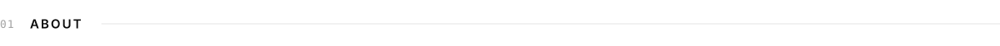
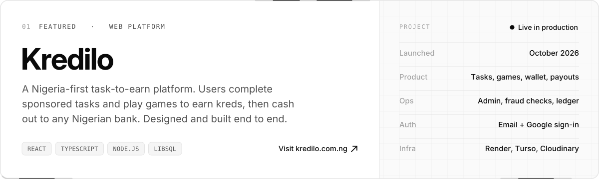
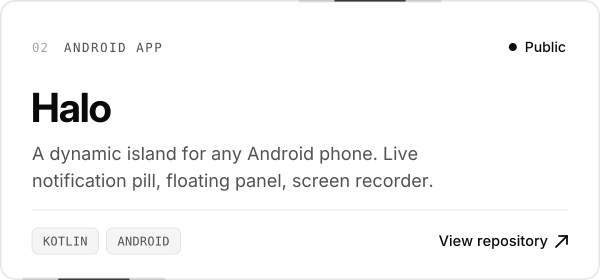
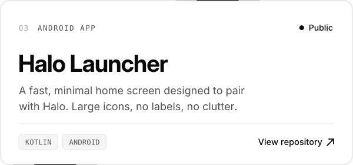
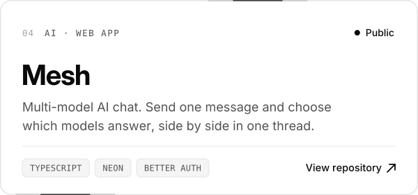
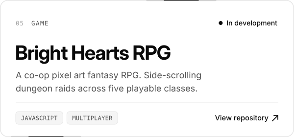
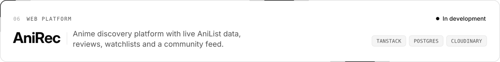
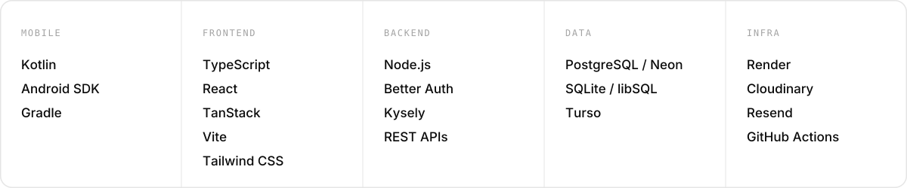

<picture>
  <source media="(prefers-color-scheme: dark)" srcset="./assets/banner-dark.svg">
  
</picture>

  

<picture>
  <source media="(prefers-color-scheme: dark)" srcset="./assets/h-about-dark.svg">
  
</picture>

I'm a software developer from Lagos, Nigeria. I design and build Android apps, full-stack web platforms and games, and I take products all the way from database schema to the last pixel of UI.

My flagship product, **[Kredilo](https://kredilo.com.ng)**, is live in production with real users. Alongside it I'm building **Halo**, a dynamic island for Android, and **Bright Hearts RPG**, a co-op pixel art game.

- **Focus:** Android (Kotlin), full-stack TypeScript, game development
- **Currently:** growing Kredilo, building Halo and Bright Hearts RPG
- **Studying at:** FUNAAB (Federal University of Agriculture, Abeokuta)

 

<picture>
  <source media="(prefers-color-scheme: dark)" srcset="./assets/h-work-dark.svg">
  
</picture>

<a href="https://kredilo.com.ng">
  <picture>
    <source media="(prefers-color-scheme: dark)" srcset="./assets/featured-kredilo-dark.svg">
    
  </picture>
</a>

  <a href="https://github.com/LONERXONE-ops/halo"><picture><source media="(prefers-color-scheme: dark)" srcset="./assets/card-halo-dark.svg"></picture></a>
  <a href="https://github.com/LONERXONE-ops/halo-launcher"><picture><source media="(prefers-color-scheme: dark)" srcset="./assets/card-halo-launcher-dark.svg"></picture></a>
  <a href="https://github.com/LONERXONE-ops/mesh"><picture><source media="(prefers-color-scheme: dark)" srcset="./assets/card-mesh-dark.svg"></picture></a>
  <a href="https://github.com/LONERXONE-ops/Bright-hearts-RPG"><picture><source media="(prefers-color-scheme: dark)" srcset="./assets/card-bright-hearts-dark.svg"></picture></a>

<picture>
  <source media="(prefers-color-scheme: dark)" srcset="./assets/card-anirec-dark.svg">
  
</picture>

  

<picture>
  <source media="(prefers-color-scheme: dark)" srcset="./assets/h-stack-dark.svg">
  
</picture>

<picture>
  <source media="(prefers-color-scheme: dark)" srcset="./assets/stack-dark.svg">
  
</picture>

  

<picture>
  <source media="(prefers-color-scheme: dark)" srcset="./assets/h-other-dark.svg">
  
</picture>

| Project | Description | Built with |
|---|---|---|
| **WhatsApp Anime Bot** | Anime and manga lookups, media downloads with live progress, and an AI companion with image understanding. | Node.js, Baileys, AniList, Jikan |
| **ATELIER 88** | A full 88-key piano in the browser with keyboard mapping, sustain and sampled grand piano sound. | React, Tone.js |
| **Space Divers: Nova Protocol** | Browser game with ten zones, an in-game store, a token economy and persistent saves. | JavaScript, HTML5 |

 

<picture>
  <source media="(prefers-color-scheme: dark)" srcset="./assets/footer-dark.svg">
  
</picture>
