<a href="https://github.com/LONERXONE-ops">
  
</a>

<p align="center">
  <a href="https://kredilo.com.ng"></a>
  
  
  
</p>

<br>

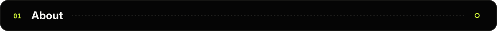

I build Android apps, full-stack web platforms and games. **No laptop.** Every repo on this profile was written, built and shipped from a Samsung Galaxy A06 running Termux.

```yaml
handle:    LONERXONE
based:     Lagos, Nigeria  (GMT+1)
studying:  FUNAAB
setup:     Galaxy A06 · Termux · Node · git
shipping:  Kredilo (live), Halo, Bright Hearts RPG
into:      anime, pixel games, pure black UI
```

<br>

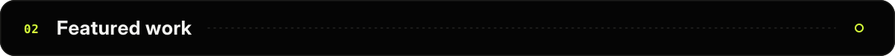

<p align="center">
  <a href="https://kredilo.com.ng"></a>
  <a href="https://github.com/LONERXONE-ops/halo">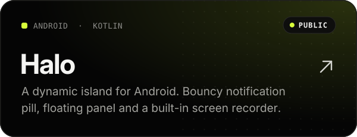</a>
  <a href="https://github.com/LONERXONE-ops/halo-launcher">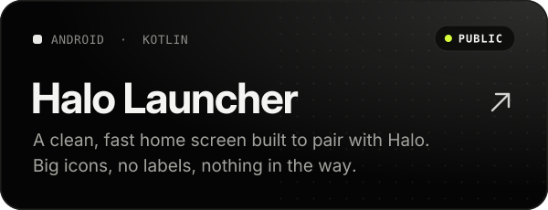</a>
  <a href="https://github.com/LONERXONE-ops/Bright-hearts-RPG">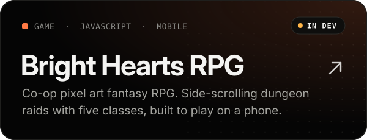</a>
  <a href="https://github.com/LONERXONE-ops/mesh">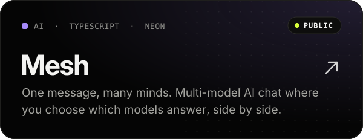</a>
  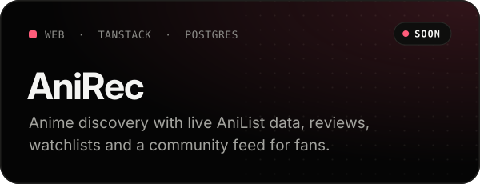
</p>

<br>

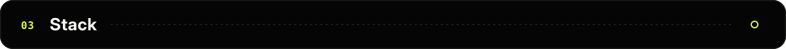

<p align="center">
  
</p>

<br>

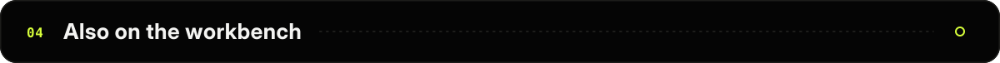

| | |
|---|---|
| **ANIME BOT** | WhatsApp bot on Node.js + Baileys. Anime and manga lookups, downloads with live progress, and Kari, an AI companion with vision. Runs 24/7 in Termux. |
| **ATELIER 88** | A full 88-key browser piano. Tone.js, Salamander samples, keyboard mapping and sustain. |
| **Space Divers: Nova Protocol** | Single-file browser game. Ten zones, an in-game store and a token economy behind a holographic OS-style UI. |

<br>

<a href="https://github.com/LONERXONE-ops">
  
</a>
